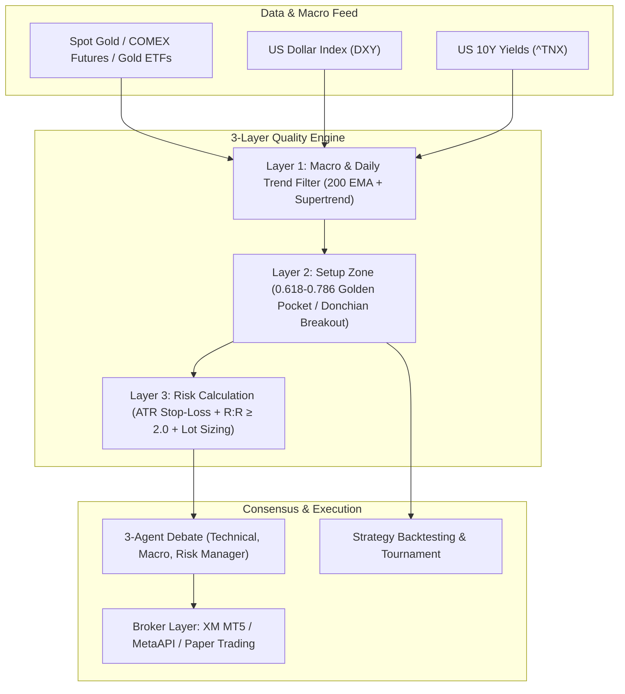

# 🏆 Institutional Gold Trading System MCP

A specialized, quantitative **Gold Trading MCP Server** designed for Spot Gold ($XAU/USD$), COMEX Gold Futures ($GC=F$), and Gold ETFs ($GLD$, $GOLDBEES.NS$).

Featuring **Multi-Timeframe Trend Filtering**, **Fibonacci 0.618-0.786 Golden Pocket Detection**, **Macro Dollar & Yield Confluence**, **3-Agent Debate Consensus**, **Pure Python Backtesting**, and direct execution via **XM Broker (MT5 / MetaAPI)** and simulated **Paper Trading**.

---

## 🌟 Key Architecture & Capabilities



---

## 📂 Project Structure

```
/home/mcpuser/MCP/gold-trading-system/
├── pyproject.toml              # Project packaging & dependencies
├── requirements.txt            # Python dependencies
├── .env.example                # XM broker and risk environment configuration
├── src/
│   └── gold_trader/
│       ├── __init__.py
│       ├── config.py           # Central configuration & symbol registry
│       ├── types.py            # TypedDicts & Data models
│       ├── core/
│       │   ├── indicators.py   # Pure Python technical indicators (Supertrend, Donchian, EMA, RSI, ATR)
│       │   ├── fibonacci.py    # Fibonacci retracement & 0.618-0.786 Golden Pocket engine
│       │   ├── macro.py        # DXY Dollar Index & US 10Y Yields correlation
│       │   ├── data_feed.py    # Multi-market gold & macro data provider
│       │   ├── strategy_engine.py # 3-Layer institutional trade setup generator
│       │   ├── multi_agent.py  # 3-Agent debate & consensus framework
│       │   └── backtester.py   # Strategy backtester with transaction costs
│       ├── brokers/
│       │   ├── base.py         # Abstract Base Broker interface
│       │   ├── paper_broker.py # Local SQLite paper trading broker
│       │   ├── xm_mt5_broker.py# Native XM MetaTrader 5 broker (Windows/VPS)
│       │   └── metaapi_broker.py # Cloud REST MetaAPI broker (Linux/Docker)
│       └── server.py           # FastMCP server exposing all tools
└── tests/
    └── test_gold_system.py     # Comprehensive unit tests
```

---

## 🚀 Quick Start

### 1. Installation

```bash
cd /home/mcpuser/MCP/gold-trading-system
pip install -e .
```

### 2. Configure Environment

Copy `.env.example` to `.env` and configure your broker:

```bash
cp .env.example .env
```

#### A. Free MT5 Socket Bridge (Option 3 - Recommended & $0 Cost):
Direct local TCP communication with XM MT5 without any cloud subscription fees:
```ini
BROKER_MODE=socket
XM_ACCOUNT_TYPE=demo   # "demo" or "live"
MT5_BRIDGE_HOST=127.0.0.1
MT5_BRIDGE_PORT=8888
```
*Attach `mql5/GoldTraderBridge.mq5` to any chart in XM MT5.*

#### B. Simulated Mode (Paper Trading):
```ini
BROKER_MODE=paper
DEFAULT_SYMBOL=XAUUSD
DEFAULT_RISK_PER_TRADE_PCT=1.0
```

#### C. Native XM MT5 (Windows / VPS with MetaTrader5 package):
```ini
BROKER_MODE=xm_mt5
XM_ACCOUNT_TYPE=demo   # Toggle between "demo" and "live"

# XM Demo Account
XM_DEMO_LOGIN=12345678
XM_DEMO_PASSWORD=your_demo_password
XM_DEMO_SERVER=XMGlobal-MT5

# XM Live Account (⚠️ Real Capital)
XM_LIVE_LOGIN=87654321
XM_LIVE_PASSWORD=your_live_password
XM_LIVE_SERVER=XMGlobal-MT5
```

#### D. MetaAPI Cloud Gateway (Paid Cloud Subscription):
```ini
BROKER_MODE=metaapi
XM_ACCOUNT_TYPE=demo

METAAPI_TOKEN=your_metaapi_token
METAAPI_DEMO_ACCOUNT_ID=your_demo_account_id
METAAPI_LIVE_ACCOUNT_ID=your_live_account_id
```

### 3. Run the MCP Server

```bash
# stdio mode (for Claude Desktop / Antigravity / Cursor)
python3 -m gold_trader.server

# or streamable HTTP mode
python3 -m gold_trader.server streamable-http --port 8001
```

### 4. Run Unit Tests

```bash
PYTHONPATH=src python3 -m unittest discover -s tests -p "test_*.py"
```

---

## 🛠️ Available MCP Tools

### 📊 Market Intelligence & Analysis
| Tool | Description |
| :--- | :--- |
| `gold_market_snapshot` | Synchronized snapshot of Spot Gold, COMEX Futures, Gold ETFs, DXY, and US10Y. |
| `gold_technical_analysis` | Multi-timeframe indicators (EMAs 20/50/200, Supertrend, Donchian, Bollinger, RSI, MACD, ATR, ADX). |
| `gold_fibonacci_analysis` | Swing highs/lows, **0.618 - 0.786 Golden Pocket**, supports/resistances, and extension targets. |
| `gold_macro_analysis` | Macro Gold headwinds/tailwinds score from US Dollar Index (DXY) and US 10-Year Treasury Yields. |

### 🎯 Trade Generation & Consensus
| Tool | Description |
| :--- | :--- |
| `gold_trade_setup` | High-conviction 3-layer trade setup with exact Entry, Stop-Loss ($1.5\times\text{ATR}$), Targets (T1/T2), and risk-adjusted Lot Sizing. |
| `gold_multi_agent_debate` | 3-agent debate (**Technical Analyst**, **Macro/Yields Analyst**, **Risk Manager**) reaching a consensus rating (`STRONG BUY`, `BUY`, `HOLD`, `SELL`, `STRONG SELL`). |

### 🚀 30-Level Compounding Ladder & Machine Learning
| Tool | Description |
| :--- | :--- |
| `get_compounding_ladder_status` | Query active level, balance, and next stage parameters for the 30-Level Compounding Plan ($20 -> $52,384). |
| `generate_compounding_ladder_setup_tool`| Evaluates live Gold market against ML High-Probability Gatekeeper ($P(\text{Win}) \ge 70\%$) with exact 20-pip TP / 15-pip SL bracket. |
| `execute_compounding_ladder_trade` | Automatically executes the ladder stage bracket order on active broker (XM MT5 / Paper) if ML probability is approved. |
| `predict_gold_trade_probability` | Evaluates live microstructure, session, and macro state to predict win probability for BUY or SELL. |
| `train_gold_ml_model` | Trains or recalibrates the Gradient Boosting Triple-Barrier Meta-Classifier with walk-forward cross-validation. |
| `reset_compounding_ladder` | Resets the compounding ladder to Level 1 ($20) with selectable loss policies. |
| `set_compounding_ladder_level` | Manually sets active level (1 to 30) to align with existing account balance. |

### 📈 Strategy Backtesting
| Tool | Description |
| :--- | :--- |
| `gold_backtest` | Backtest Gold strategies (`supertrend`, `donchian`, `ema_cross`, `bollinger`) with transaction costs & Sharpe/Calmar metrics. |
| `gold_compare_strategies` | Run all strategies in parallel and rank them on total return, win rate, and max drawdown. |

### 💼 Broker Execution (XM MT5 / MetaAPI / Paper Trading)
| Tool | Description |
| :--- | :--- |
| `broker_account_info` | Query live balance, equity, free margin, margin level, and leverage. |
| `broker_open_positions` | Monitor open trades, tickets, lot sizes, and floating PnL. |
| `broker_place_order` | Execute a BUY or SELL order with volume and automatic SL/TP. |
| `broker_modify_position`| Modify Stop-Loss or Take-Profit of an open trade. |
| `broker_close_position` | Close an open trade by ticket number. |

---

## 🔒 Safety & Risk Management

- **Risk Per Trade Enforcement**: Never trades fixed lot sizes; dynamically calculates lot size so losing a trade costs exactly `DEFAULT_RISK_PER_TRADE_PCT`% of account balance.
- **Dynamic ATR Stops**: Anchored beyond market noise ($1.5\times\text{ATR}$) to prevent premature stop-outs.
- **Top-Down Trend Filter**: Prevents taking 5m/15m counter-trend trades against the Daily macro direction.
