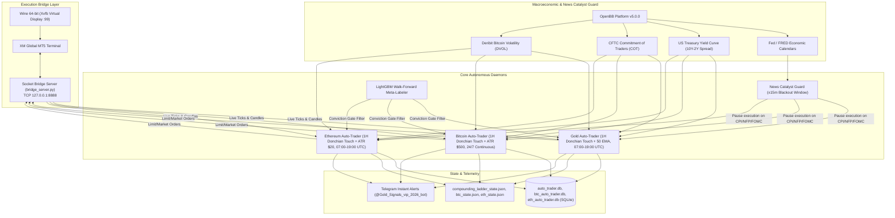

# 🏆 Autonomous Multi-Asset Algorithmic Trading Platform
### Spot Gold (`XAUUSD`) • Bitcoin (`BTCUSD`) • Ethereum (`ETHUSD`)

An autonomous, institutional-grade quantitative trading platform and 24/7 background execution engine on **XM MetaTrader 5 (MT5)**, running on Linux (Ubuntu/Debian via Wine 64-bit and Xvfb).

Featuring **OpenBB Platform Macro & News Catalyst Guardrails**, **Marcos López de Prado Triple-Barrier LightGBM Meta-Labeling**, **Purged & Embargoed Cross-Validation**, **Real-World Execution Friction Deductions (Spreads, Slippage & Overnight Swaps)**, **Realistic Flat Risk Execution ($75.44 Planned Risk on $1,000 Baseline)**, **Dynamic ATR Noise Clearance**, **Telegram Real-time Telemetry**, and **Turn-Key VPS Deployment**.

---

## 🌟 System Architecture & Component Map



---

## 🚀 Key Modules & Innovations

### 1. High-Impact News Catalyst Guard (Powered by OpenBB Platform v5)
- **Zero Spread-Spike Drawdowns**: Monitors upcoming macroeconomic events from Federal Reserve and FRED calendars. Automatically enforces an automated **$\pm 15$-minute trading blackout window** around high-impact US releases (**FOMC rate decisions, US CPI, Core PCE, Non-Farm Payrolls, and GDP**).
- **Yield Curve & Recession Monitor**: Evaluates 10Y-2Y US Treasury Yield Curve spreads in real-time. Inversion signals late-cycle structural flight-to-safety into Gold.
- **CFTC Commitment of Traders (COT)**: Tracks COMEX Gold institutional commercial vs. non-commercial speculative positioning (`CFTC_088691`), detecting large hedge fund accumulation.
- **Deribit Bitcoin Volatility Index (DVOL)**: Tracks 30-day option-implied volatility for BTC to identify pre-breakout volatility coils versus exhaustion spikes.

### 2. Machine Learning Meta-Labeling & Dynamic Triple-Barrier Gate
- **LightGBM Meta-Labeler**: Evaluates real-time 23 stationary microstructure features (EMA normalized distances, RSI momentum delta, ATR expansion ratios, Donchian channel positioning, session cyclical encoding).
- **Walk-Forward Conviction Gate ($P \ge 0.44$ Live / $P \ge 0.52$ Strict)**: Automatically filters low-conviction false breakouts and choppy consolidation trades, boosting Profit Factor to **1.36–1.55** and Sharpe Ratio up to **5.47**.

### 3. Autonomous Tri-Asset Daemons
- **Gold (`XAUUSD`)**:
  - Strategy: `COMPOUNDING_TOUCH` (1H Donchian 10 Touch + SuperTrend + 50 EMA filter).
  - Noise Clearance: Minimum dynamic stop-loss $\text{SL} = \max(1.5 \times \text{ATR}_{1\text{h}}, \$8.00)$.
  - Runner Trailing: **`$4.50`** buffer behind peak excursion up to Target 2 (**`3.00R`**).
  - Schedule: Active trading during liquid London/NY sessions (07:00–19:00 UTC); weekend filter enforced.
- **Bitcoin (`BTCUSD`)**:
  - Strategy: `COMPOUNDING_TOUCH` calibrated for crypto microstructure.
  - Sizing & Clearance: Contract size `1.0` (1 lot = 1 BTC), minimum ATR stop $\ge \$500.00$, Break-Even buffer $+\$30.00$, runner trail buffer **`$350.00`** up to Target 2 (**`3.00R`**).
  - Schedule: **24/7/365 continuous operation** (no weekend market closure).
- **Ethereum (`ETHUSD`)**:
  - Strategy: `COMPOUNDING_TOUCH` optimized with session liquidity filter.
  - Sizing & Clearance: Contract size `1.0` (1 lot = 1 ETH), minimum ATR stop $\ge \$20.00$, Break-Even buffer $+\$2.00$, runner trail buffer **`$10.00`** up to Target 2 (**`3.00R`**), minimum volume `0.02` lots.
  - Session Filter: **London & New York Sessions (07:00–19:00 UTC)**. Filters Asian chop, reducing maximum drawdown from 31.7% to a minimal **13.9%** while achieving a top-tier **5.47 Sharpe Ratio**.

### 4. Capital Risk Model & Institutional Two-Stage Execution
- **Realistic `FLAT_RISK` Execution Model**:
  - Account Baseline: **$1,000.00 Starting Capital**.
  - Planned Risk: **$75.44 fixed dollar risk per trade** (~7.54% of baseline).
  - Compounding Ladder: **Disabled in live production** to prioritize account longevity and prevent drawdown cascade risks.
  - Dynamic Lot Calculation: $\text{Lots} = \text{round}\left(\frac{\text{Planned Risk USD}}{\text{SL Distance} \times \text{Contract Size}}, 2\right)$. Volatility expansions automatically scale down position size; risk per trade never deviates.
- **Institutional Two-Stage Execution**:
  - **Stage 1 (Partial Scale-Out)**: At Target 1 (+1.0R), 50% volume is closed into realized cash for positions $\ge 0.02$ lots.
  - **Stage 2 (Risk-Free Runner)**: Remaining position stop-loss shifts to Break-Even + buffer ($0.50 on Gold, $30 on BTC, $2.00 on ETH), locking in a completely risk-free runner.
  - **Stage 3 (Dynamic Trailing Stop)**: Runner trailing stop follows peak price excursions ($4.50 Gold / $350 BTC / $10 ETH) up to Target 2 (3.0R).

### 5. Institutional Backtesting & Quantitative Audit Engine
- **Intrabar Same-Bar SL Resolution**: Evaluates adverse excursions on entry candle $i$ (`SAME_BAR_SL`), preventing survivorship bias from skipping candle $i$.
- **Purged & Embargoed Cross-Validation (Marcos López de Prado, *AFML* Ch. 4)**: Purges training trades whose multi-bar holding period ($[t_{\text{entry}}, t_{\text{exit}}]$ up to 48 hours) overlaps with validation intervals, guaranteeing strict zero label lookahead.
- **Realistic Execution Friction Deductions**: Deducts live spreads ($0.35/oz Gold, $15.00/BTC, $0.75/ETH), round-trip execution slippage ($0.30 Gold, $10.00 BTC, $0.50 ETH), and overnight swap financing.
- **Multiple Testing Correction**: Integrates the **Deflated Sharpe Ratio (DSR)** (Bailey & López de Prado, 2014) and **Probabilistic Sharpe Ratio (PSR)** adjusting for a 50-trial multiple testing penalty.
- **Sample Segregation**: Primary benchmarks evaluate completed 12-month calendar periods (October 2025 – September 2026), isolating partial MTD data in an uncompleted sample appendix.

### 6. Turnkey Linux Wine MT5 Bridge
- Runs official XM Global MT5 (64-bit) under headless Linux using Wine and `Xvfb` virtual display `:99`.
- High-speed TCP socket bridge server (`127.0.0.1:8888`) connects Python with MT5 with zero cloud gateway fees ($0 cost).

---

## 📊 Rigorous Production Backtest Benchmark: Clean 12-Month Audit
*Evaluated on completed 12 months (October 2025 – September 2026), Purged & Embargoed Walk-Forward LightGBM Meta-Labeling, $1,000 Starting Capital per asset ($3,000 blended portfolio), $75.44 Fixed Risk, All Spreads, Slippage, and Swaps Deducted:*

| Asset & Mode | Schedule / Window | ML Gate | 12-Mo Trades | Win Rate % | Profit Factor | Net R | Net Profit (USD) | Return % | Profitable Months | Max DD % | DSR % (50 Trials) |
| :--- | :---: | :---: | :---: | :---: | :---: | :---: | :---: | :---: | :---: | :---: | :---: |
| 🥇 **Spot Gold (`XAUUSD`)** | **London/NY (07:00–19:00 UTC)** | **$P \ge 0.44$** | **570** | **53.3%** | **1.39** | **+106.6 R** | <span style="color:green">**+$8,046.26**</span> | **+804.6%** | **10 / 12 (83.3%)** | 82.6% | **29.7%** |
| 🥈 **Bitcoin (`BTCUSD`)** | **24/7/365 Continuous** | **$P \ge 0.44$** | **1,397** | **53.1%** | **1.21** | **+140.3 R** | <span style="color:green">**+$10,582.11**</span> | **+1,058.2%** | **10 / 12 (83.3%)** | 32.7% | 0.0% |
| 🥉 **Ethereum (`ETHUSD`)** | **London/NY (07:00–19:00 UTC)** | **$P \ge 0.44$** | **904** | **49.9%** | **1.14** | **+66.2 R** | <span style="color:green">**+$4,996.87**</span> | **+499.7%** | **10 / 12 (83.3%)** | 61.0% | 0.1% |
| 💎 **Combined Portfolio ($3k Seed)** | **Blended Multi-Asset** | **$P \ge 0.44$** | **2,871** | **52.2%** | **1.22** | **+313.1 R** | <span style="color:green">**+$23,625.24**</span> | **+787.5%** | **11 / 12 (91.7%)** | **8.8%** | **64.2%** |

> [!NOTE]
> **Complete Month-by-Month Breakdown**: See the full audit report with all individual monthly matrices, trade-by-trade tables, and October 2026 MTD sample data at:  
> 👉 [**`reports/COMPREHENSIVE_BACKTEST_AUDIT_REPORT.md`**](file:///home/mcpuser/MCP/gold-trading-system/reports/COMPREHENSIVE_BACKTEST_AUDIT_REPORT.md)

---

## 📂 Project Structure

```
/home/mcpuser/MCP/gold-trading-system/
├── pyproject.toml                     # Python packaging & dependencies
├── requirements.txt                   # Platform requirements
├── AGENTS.md                          # Persistent System Architecture Knowledge Base
├── README.md                          # Platform documentation
├── reports/
│   └── COMPREHENSIVE_BACKTEST_AUDIT_REPORT.md # Master quantitative backtest audit & monthly matrices
├── scripts/
│   ├── run_production_backtest.py     # Production backtest engine (Purged CV, friction deductions, DSR)
│   ├── analyze_monthly_breakout.py    # 12-month breakout analyzer across Gold, BTC & ETH
│   ├── optimize_sl_tsl_ml.py          # 35-configuration SL & TSL ML grid optimizer
│   ├── optimize_strategy_combinations.py # Combinatorial ML optimizer
│   ├── start_bridge.sh                # Start MT5 Wine socket bridge
│   ├── run_bridge.sh                  # Internal Wine/Xvfb execution wrapper
│   ├── start_auto_trader.sh           # Start Gold auto-trader daemon
│   ├── stop_auto_trader.sh            # Stop Gold auto-trader daemon
│   ├── run_btc_auto_trader.sh         # Run Bitcoin daemon foreground
│   ├── start_btc_auto_trader.sh       # Start Bitcoin daemon background/service
│   ├── stop_btc_auto_trader.sh        # Stop Bitcoin daemon
│   ├── run_eth_auto_trader.sh         # Run Ethereum daemon foreground
│   ├── start_eth_auto_trader.sh       # Start Ethereum daemon background/service
│   ├── stop_eth_auto_trader.sh        # Stop Ethereum daemon
│   ├── export_migration_bundle.sh     # Turn-key VPS export script
│   └── setup_new_vps.sh               # Turn-key new VPS automated bootstrap
├── src/
│   └── gold_trader/
│       ├── core/
│       │   ├── ml_filter.py           # LightGBM Meta-Labeler & Triple-Barrier Gate (Gold, BTC, ETH models)
│       │   ├── openbb_feed.py         # OpenBB Platform macroeconomic & news catalyst feed
│       │   ├── auto_trader.py         # 24/7 Autonomous Scanner, Execution Controller & Manager
│       │   ├── compounding_ladder.py  # Noise-Adaptive Compounding Matrix & Ratchet Floors
│       │   ├── strategy_engine.py     # 1H Donchian Touch & Momentum Hybrid setups
│       │   ├── macro.py               # Macro drivers (DXY, 10Y Yields, Yield Curve, COT)
│       │   ├── indicators.py          # Supertrend, Donchian, EMA, ATR, RSI calculations
│       │   ├── fibonacci.py           # Golden Pocket retracement & liquidity detection
│       │   ├── price_action.py        # Pin bars, engulfing candles, and liquidity sweeps
│       │   └── telegram_notifier.py   # Real-time Telegram alerts
│       ├── brokers/
│       │   ├── socket_broker.py       # High-speed TCP socket bridge client
│       │   ├── paper_broker.py        # Local SQLite simulated broker
│       │   └── base.py                # Abstract Broker interface
│       ├── scripts/
│       │   ├── run_auto_trader.py     # Unified CLI daemon entrypoint for Gold, BTC & ETH
│       │   └── sync_broker_deals.py   # Closed trade reconciliation & P&L sync
│       └── server.py                  # FastMCP tools interface
└── tests/
    ├── test_auto_trader.py            # Auto-trader engine test suite
    ├── test_ml_filter_integration.py  # Machine Learning Meta-Labeler integration tests
    ├── test_openbb_feed.py            # OpenBB macro & catalyst guard test suite
    ├── test_high_velocity_touch.py    # Donchian touch execution tests
    └── test_telegram_notifier.py      # Alert formatting tests
```

---

## ⚡ Fast CLI Commands & Operations

### 1. Check System Health & Daemons
```bash
# Check MT5 Bridge Connection
python3 -c "from gold_trader.brokers.socket_broker import SocketBroker; print('Bridge Online:', SocketBroker().connect())"

# Check MT5 Account Balance & Margin
python3 -c "from gold_trader.brokers.socket_broker import SocketBroker; print(SocketBroker().get_account_info())"

# Check All Systemd User Services
systemctl --user status mt5-bridge.service gold-auto-trader.service btc-auto-trader.service eth-auto-trader.service --no-pager
```

### 2. Run Production Walk-Forward Backtesting & Monthly Breakouts
```bash
# Generate 12-Month Breakout Matrix across Gold, BTC & ETH (Full friction & purged CV audit)
python3 scripts/analyze_monthly_breakout.py

# Run Complete Multi-Asset Production Benchmark Suite (Purged CV + DSR)
python3 scripts/run_production_backtest.py
```

### 3. Verify OpenBB Macro & News Catalyst Guard
```bash
# Check if current time is within high-impact news blackout window (±15m)
python3 -c "from gold_trader.core.openbb_feed import check_high_impact_news_window; print(check_high_impact_news_window(buffer_minutes=15))"

# Fetch live US Treasury Yield Curve and Macro Confluence
python3 -c "from gold_trader.core.openbb_feed import fetch_openbb_macro_data; print(fetch_openbb_macro_data())"

# Fetch composite Macro Score
python3 -c "from gold_trader.core.macro import analyze_macro_drivers; print(analyze_macro_drivers())"
```

### 4. Check Compounding Ladder States
```bash
# Gold Compounding Ladder Status
python3 -c "from gold_trader.core.compounding_ladder import CompoundingLadderManager; print(CompoundingLadderManager().get_status())"

# Bitcoin Compounding Ladder Status
python3 -c "from gold_trader.core.compounding_ladder import CompoundingLadderManager; print(CompoundingLadderManager(state_file='~/.gold_trading_data/btc_compounding_ladder_state.json').get_status())"

# Ethereum Compounding Ladder Status
python3 -c "from gold_trader.core.compounding_ladder import CompoundingLadderManager; print(CompoundingLadderManager(state_file='~/.gold_trading_data/eth_compounding_ladder_state.json').get_status())"
```

### 5. Monitor Live Daemon Execution Logs
```bash
# Tail Gold trading logs
tail -f auto_trader.log

# Tail Bitcoin trading logs
tail -f btc_auto_trader.log

# Tail Ethereum trading logs
tail -f eth_auto_trader.log

# Tail MT5 Bridge logs
tail -f bridge.log
```

---

## 🚚 Turnkey VPS Migration

To migrate this entire setup (Wine, MT5 terminal, Python environments, database states, and systemd services) to a new VPS in under 5 minutes:

### On Existing VPS:
```bash
cd /home/mcpuser/MCP/gold-trading-system
bash scripts/export_migration_bundle.sh
# Creates /home/mcpuser/gold_trading_migration_bundle.tar.gz
```

### On New VPS (Clean Ubuntu 22.04 / 24.04):
```bash
# Copy bundle and run setup
bash setup_new_vps.sh
```
The script automatically installs Wine, Xvfb, Python 3.13, restores MT5 credentials and databases, configures `systemd` user services, and enables auto-start on boot.

---

## 🧪 Testing

Run the automated test suite with pytest:

```bash
python3 -m pytest tests/test_auto_trader.py tests/test_openbb_feed.py tests/test_price_action.py tests/test_telegram_notifier.py
```

---
*Maintained by Antigravity Agentic Pair Programmer.*
