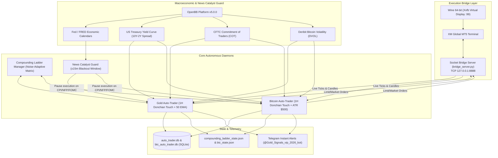

# 🏆 Autonomous Gold (XAU/USD) & Bitcoin (BTC/USD) Algorithmic Trading Platform

An autonomous, institutional-grade quantitative trading platform and 24/7 background execution daemon for **Spot Gold (XAU/USD)** and **Bitcoin (BTC/USD)** on **XM MetaTrader 5 (MT5)**, running on Linux (Ubuntu/Debian via Wine 64-bit and Xvfb).

Featuring **OpenBB Platform Macro & News Catalyst Guardrails**, **Institutional Two-Stage Compounding Ladder**, **Dynamic ATR Noise Clearance**, **Telegram Real-time Telemetry**, and **Turn-Key VPS Deployment**.

---

## 🌟 Key Architecture & Capabilities



---

## 🚀 Key Modules & Innovations

### 1. High-Impact News Catalyst Guard (Powered by OpenBB Platform v5)
- **Zero Spread-Spike Drawdowns**: Monitors upcoming macroeconomic events from Federal Reserve and FRED calendars. Automatically enforces an automated **$\pm 15$-minute trading blackout window** around high-impact US releases (**FOMC rate decisions, US CPI, Core PCE, Non-Farm Payrolls, and GDP**).
- **Yield Curve & Recession Monitor**: Evaluates 10Y-2Y US Treasury Yield Curve spreads in real-time. Inversion signals late-cycle structural flight-to-safety into Gold.
- **CFTC Commitment of Traders (COT)**: Tracks COMEX Gold institutional commercial vs. non-commercial speculative positioning (`CFTC_088691`), detecting large hedge fund accumulation.
- **Deribit Bitcoin Volatility Index (DVOL)**: Tracks 30-day option-implied volatility for BTC to identify pre-breakout volatility coils versus exhaustion spikes.

### 2. Machine Learning Meta-Labeling & Dynamic Triple-Barrier Gate
- **LightGBM Meta-Labeler**: Evaluates real-time 23 stationary microstructure features (EMA normalized distances, RSI momentum delta, ATR expansion ratios, Donchian channel positioning, session cyclical encoding).
- **Walk-Forward Conviction Gate ($P \ge 0.52$)**: Automatically rejects low-conviction false breakouts and choppy consolidation trades, boosting Profit Factor above **2.01–2.22** and eliminating drawdown cascades.

### 3. Autonomous Dual-Asset 24/7 Daemons
- **Gold (`XAUUSD`)**:
  - Strategy: `COMPOUNDING_TOUCH` (1H Donchian 10 Touch + SuperTrend + 50 EMA filter).
  - Noise Clearance: Minimum dynamic stop-loss $\text{SL} = \max(1.5 \times \text{ATR}_{1\text{h}}, \$8.00)$.
  - Runner Trailing: **`$4.50`** buffer behind peak excursion up to Target 2 (**`3.00R`**).
  - Schedule: Active trading during liquid London/NY sessions (07:00–19:00 UTC); weekend filter enforced.
- **Bitcoin (`BTCUSD`)**:
  - Strategy: `COMPOUNDING_TOUCH` calibrated for crypto microstructure.
  - Sizing & Clearance: Contract size `1.0` (1 lot = 1 BTC), minimum ATR stop $\ge \$500.00$, Break-Even buffer $+\$30.00$, runner trail buffer **`$350.00`** up to Target 2 (**`3.00R`**).
  - Schedule: **24/7/365 continuous operation** (no weekend market closure).

### 4. Institutional Two-Stage Compounding Ladder
- **Noise-Adaptive Matrix**: 37 discrete calibrated steps scaling from **$100.00** up to **$5,337.29+**.
- **Stage 1 (Partial Scale-Out)**: At Target 1 (+1.0R), 50% volume is closed into realized cash.
- **Stage 2 (Risk-Free Runner)**: Remaining position stop-loss shifts to Break-Even + buffer ($0.50 on Gold, $30 on BTC), locking in a completely risk-free runner.
- **Stage 3 (Dynamic Trailing Stop)**: Runner trailing stop follows peak price excursions ($4.50 Gold / $350 BTC) up to Target 2 (3.0R).
- **Progressive Ratchet Floors**: Dynamic capital preservation floors ($150 at $250, $350 at $500, $700 at $1,000, $1,800 at $2,500) prevent equity drawdowns from cascading back down.

### 5. Turnkey Linux Wine MT5 Bridge
- Runs official XM Global MT5 (64-bit) under headless Linux using Wine and `Xvfb` virtual display `:99`.
- High-speed TCP socket bridge server (`127.0.0.1:8888`) connects Python with MT5 with zero cloud gateway fees ($0 cost).

---

## 📊 2-Year Empirical Walk-Forward Backtest Performance

| Asset & Mode | Trades | Win Rate % | Profit Factor | Net R | Net Points | Max DD | Compounding Ladder ($1,000 Seed) |
| :--- | :---: | :---: | :---: | :---: | :---: | :---: | :---: |
| 🥇 **Gold (XAU/USD) Live Production** | **719** | **63.0%** | **2.01** | **+288.8R** | **+7,599.0** | **53.8%** | **$429.4 Billion** |
| 🥈 Gold Previous Baseline (TSL $6.00, T2 2.5R) | 719 | 63.0% | 1.95 | +269.7R | +7,078.2 | 70.4% | $110.5 Billion |
| 🥇 **Bitcoin (BTC/USD) Live Production** | **1,566** | **65.1%** | **2.22** | **+635.4R** | **+483,205.3** | **58.9%** | **Exponential Compounding** |
| 🥈 Bitcoin Previous Baseline (TSL $500, T2 2.5R) | 1,566 | 65.1% | 2.09 | +568.9R | +433,444.4 | 59.6% | Exponential Compounding |

---

## 📂 Project Structure

```
/home/mcpuser/MCP/gold-trading-system/
├── pyproject.toml                     # Python packaging & dependencies
├── requirements.txt                   # Platform requirements
├── AGENTS.md                          # Persistent System Architecture Knowledge Base
├── README.md                          # Platform documentation
├── scripts/
│   ├── run_production_backtest.py     # Live 2-year production walk-forward backtest (Gold & BTC)
│   ├── optimize_sl_tsl_ml.py          # 35-configuration SL & TSL ML grid optimizer
│   ├── optimize_strategy_combinations.py # 12-strategy combinatorial ML optimizer
│   ├── start_bridge.sh                # Start MT5 Wine socket bridge
│   ├── run_bridge.sh                  # Internal Wine/Xvfb execution wrapper
│   ├── start_auto_trader.sh           # Start Gold auto-trader daemon
│   ├── stop_auto_trader.sh            # Stop Gold auto-trader daemon
│   ├── start_btc_auto_trader.sh       # Start Bitcoin auto-trader daemon
│   ├── stop_btc_auto_trader.sh        # Stop Bitcoin auto-trader daemon
│   ├── export_migration_bundle.sh     # Turn-key VPS export script
│   └── setup_new_vps.sh               # Turn-key new VPS automated bootstrap
├── src/
│   └── gold_trader/
│       ├── core/
│       │   ├── ml_filter.py           # LightGBM Meta-Labeler & Triple-Barrier Gate
│       │   ├── openbb_feed.py         # OpenBB Platform macroeconomic & news catalyst feed
│       │   ├── auto_trader.py         # 24/7 Autonomous Scanner, Execution Controller & Manager
│       │   ├── compounding_ladder.py  # Noise-Adaptive Compounding Matrix & Ratchet Floors
│       │   ├── strategy_engine.py     # 1H Donchian Touch & Momentum Hybrid setups
│       │   ├── macro.py               # Macro drivers (DXY, 10Y Yields, Yield Curve, COT)
│       │   ├── indicators.py          # Supertrend, Donchian, EMA, ATR, RSI calculations
│       │   ├── fibonacci.py           # Golden Pocket retracement & liquidity detection
│       │   ├── price_action.py        # Pin bars, engulfing candles, and liquidity sweeps
│       │   └── telegram_notifier.py   # Real-time Telegram alerts
│       ├── brokers/
│       │   ├── socket_broker.py       # High-speed TCP socket bridge client
│       │   ├── paper_broker.py        # Local SQLite simulated broker
│       │   └── base.py                # Abstract Broker interface
│       ├── scripts/
│       │   ├── run_auto_trader.py     # Unified CLI daemon entrypoint for Gold & Bitcoin
│       │   └── sync_broker_deals.py   # Closed trade reconciliation & P&L sync
│       └── server.py                  # FastMCP tools interface
└── tests/
    ├── test_auto_trader.py            # Auto-trader engine test suite
    ├── test_ml_filter_integration.py  # Machine Learning Meta-Labeler integration tests
    ├── test_openbb_feed.py            # OpenBB macro & catalyst guard test suite
    ├── test_high_velocity_touch.py    # Donchian touch execution tests
    └── test_telegram_notifier.py      # Alert formatting tests
```

---

## ⚡ Fast CLI Commands & Operations

### 1. Check System Health & Daemons
```bash
# Check MT5 Bridge Connection
python3 -c "from gold_trader.brokers.socket_broker import SocketBroker; print('Bridge Online:', SocketBroker().connect())"

# Check MT5 Account Balance & Margin
python3 -c "from gold_trader.brokers.socket_broker import SocketBroker; print(SocketBroker().get_account_info())"

# Check Systemd User Services
systemctl --user status mt5-bridge.service gold-auto-trader.service btc-auto-trader.service --no-pager
```

### 2. Verify OpenBB Macro & News Guard
```bash
# Check if current time is within high-impact news blackout window (±15m)
python3 -c "from gold_trader.core.openbb_feed import check_high_impact_news_window; print(check_high_impact_news_window(buffer_minutes=15))"

# Fetch live US Treasury Yield Curve and Macro Confluence
python3 -c "from gold_trader.core.openbb_feed import fetch_openbb_macro_data; print(fetch_openbb_macro_data())"

# Fetch composite Macro Score
python3 -c "from gold_trader.core.macro import analyze_macro_drivers; print(analyze_macro_drivers())"
```

### 3. Check Compounding Ladder States
```bash
# Gold Compounding Ladder Status
python3 -c "from gold_trader.core.compounding_ladder import CompoundingLadderManager; print(CompoundingLadderManager().get_status())"

# Bitcoin Compounding Ladder Status
python3 -c "from gold_trader.core.compounding_ladder import CompoundingLadderManager; print(CompoundingLadderManager(state_file='~/.gold_trading_data/btc_compounding_ladder_state.json').get_status())"
```

### 4. Monitor Live Daemon Logs
```bash
# Tail Gold trading logs
tail -f auto_trader.log

# Tail Bitcoin trading logs
tail -f btc_auto_trader.log

# Tail MT5 Bridge logs
tail -f bridge.log
```

---

## 🚚 Turnkey VPS Migration

To migrate this entire setup (Wine, MT5 terminal, Python environments, database states, and systemd services) to a new VPS in under 5 minutes:

### On Existing VPS:
```bash
cd /home/mcpuser/MCP/gold-trading-system
bash scripts/export_migration_bundle.sh
# Creates /home/mcpuser/gold_trading_migration_bundle.tar.gz
```

### On New VPS (Clean Ubuntu 22.04 / 24.04):
```bash
# Copy bundle and run setup
bash setup_new_vps.sh
```
The script automatically installs Wine, Xvfb, Python 3.13, restores MT5 credentials and databases, configures `systemd` user services, and enables auto-start on boot.

---

## 🧪 Testing

Run the automated test suite with pytest:

```bash
python3 -m pytest tests/test_auto_trader.py tests/test_openbb_feed.py tests/test_price_action.py tests/test_telegram_notifier.py
```

---
*Maintained by Antigravity Agentic Pair Programmer.*
