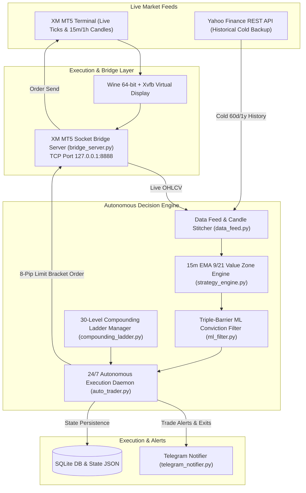

# 24/7 Autonomous Gold Trading System & 30-Level Compounding Ladder
## Comprehensive System Setup, Strategy Architecture, and Operational Runbook

---

## 1. Executive Summary & System Architecture

The **Gold Autonomous Trading System** is an institutional-grade, quantitative automated trading platform designed specifically for Gold (**XAU/USD** / Spot Gold). Operating continuously (24/7 scanning during market open), the system executes a mathematical **30-Level Compounding Ladder** designed to scale a **$20.00 micro-seed** into **$52,384.00** through fixed-fractional stage compounding.

### System Architecture Diagram



---

## 2. The 30-Level Compounding Ladder ($20 $\to$ $52,384)

The progression is governed by [`CompoundingLadderManager`](file:///home/mcpuser/MCP/gold-trading-system/src/gold_trader/core/compounding_ladder.py#L73) and calibrated to strict risk parameters:
- **Take Profit (TP)**: Fixed **20 pips** ($2.00/oz price displacement)
- **Stop Loss (SL)**: Fixed **~15.0 – 16.4 pips** ($1.50 – $1.64/oz price displacement)
- **Risk-Reward Ratio**: **1.30 – 1.33 R:R**
- **Breakeven Trigger**: At **+10 pips** ($1.00 profit), Stop Loss is immediately locked to entry price.

### Complete 30-Level Progression Matrix

| Level | Starting Balance | Lot Size | Risk ($) | Risk (%) | Target ($) | Target (%) | SL (Pips) | TP (Pips) | Ending Balance |
| :---: | :---: | :---: | :---: | :---: | :---: | :---: | :---: | :---: | :---: |
| **1** | **$20.00** | **0.03** | $5.00 | 23.0% | $6.00 | 30.0% | 15.0 | 20.0 | **$26.00** |
| **2** | $26.00 | 0.04 | $6.00 | 23.0% | $8.00 | 31.0% | 15.0 | 20.0 | $34.00 |
| **3** | $34.00 | 0.05 | $8.00 | 24.0% | $10.00 | 29.0% | 16.0 | 20.0 | $44.00 |
| **4** | $44.00 | 0.07 | $10.00 | 23.0% | $14.00 | 32.0% | 14.3 | 20.0 | $58.00 |
| **5** | $58.00 | 0.09 | $14.00 | 24.0% | $18.00 | 31.0% | 15.6 | 20.0 | $76.00 |
| **6** | $76.00 | 0.11 | $18.00 | 24.0% | $22.00 | 29.0% | 16.4 | 20.0 | $98.00 |
| **7** | $98.00 | 0.14 | $22.00 | 22.0% | $28.00 | 29.0% | 15.7 | 20.0 | $126.00 |
| **8** | $126.00 | 0.19 | $28.00 | 22.0% | $38.00 | 30.0% | 14.7 | 20.0 | $164.00 |
| **9** | $164.00 | 0.24 | $38.00 | 23.0% | $48.00 | 29.0% | 15.8 | 20.0 | $212.00 |
| **10** | $212.00 | 0.32 | $49.00 | 23.0% | $64.00 | 30.0% | 15.0 | 20.0 | $276.00 |
| **11** | $276.00 | 0.41 | $63.00 | 23.0% | $83.00 | 30.0% | 15.6 | 20.0 | $358.00 |
| **12** | $358.00 | 0.54 | $82.00 | 23.0% | $107.00 | 30.0% | 15.2 | 20.0 | $466.00 |
| **13** | $466.00 | 0.70 | $107.00 | 23.0% | $140.00 | 30.0% | 15.4 | 20.0 | $606.00 |
| **14** | $606.00 | 0.91 | $139.00 | 23.0% | $182.00 | 30.0% | 15.4 | 20.0 | $787.00 |
| **15** | $787.00 | 1.18 | $181.00 | 23.0% | $236.00 | 30.0% | 15.4 | 20.0 | $1,023.00 |
| **16** | $1,023.00 | 1.54 | $235.00 | 23.0% | $307.00 | 30.0% | 15.3 | 20.0 | $1,330.00 |
| **17** | $1,330.00 | 2.00 | $306.00 | 23.0% | $399.00 | 30.0% | 15.4 | 20.0 | $1,730.00 |
| **18** | $1,730.00 | 2.60 | $398.00 | 23.0% | $519.00 | 30.0% | 15.4 | 20.0 | $2,248.00 |
| **19** | $2,248.00 | 3.37 | $517.00 | 23.0% | $675.00 | 30.0% | 15.4 | 20.0 | $2,923.00 |
| **20** | $2,923.00 | 4.39 | $672.00 | 23.0% | $877.00 | 30.0% | 15.4 | 20.0 | $3,800.00 |
| **21** | $3,800.00 | 5.70 | $874.00 | 23.0% | $1,140.00 | 30.0% | 15.4 | 20.0 | $4,940.00 |
| **22** | $4,940.00 | 7.41 | $1,136.00 | 23.0% | $1,482.00 | 30.0% | 15.4 | 20.0 | $6,422.00 |
| **23** | $6,422.00 | 9.64 | $1,477.00 | 23.0% | $1,927.00 | 30.0% | 15.4 | 20.0 | $8,348.00 |
| **24** | $8,348.00 | 12.53 | $1,920.00 | 23.0% | $2,504.00 | 30.0% | 15.4 | 20.0 | $10,853.00 |
| **25** | $10,853.00 | 16.28 | $2,496.00 | 23.0% | $3,256.00 | 30.0% | 15.4 | 20.0 | $14,109.00 |
| **26** | $14,109.00 | 21.17 | $3,245.00 | 23.0% | $4,233.00 | 30.0% | 15.4 | 20.0 | $18,341.00 |
| **27** | $18,341.00 | 27.52 | $4,218.00 | 23.0% | $5,502.00 | 30.0% | 15.4 | 20.0 | $23,844.00 |
| **28** | $23,844.00 | 35.78 | $5,484.00 | 23.0% | $7,153.00 | 30.0% | 15.4 | 20.0 | $30,997.00 |
| **29** | $30,997.00 | 46.51 | $7,129.00 | 23.0% | $9,299.00 | 30.0% | 15.4 | 20.0 | $40,296.00 |
| **30** | **$40,296.00** | **60.46** | $9,268.00 | 23.0% | $12,089.00 | 30.0% | 15.4 | 20.0 | **$52,384.00** |

---

## 3. Core Strategy & Trade Execution Mechanics

Implemented in [`generate_intraday_value_zone_setup`](file:///home/mcpuser/MCP/gold-trading-system/src/gold_trader/core/strategy_engine.py#L256):

### A. Trend Confluence & Value Zone Filter
1. **Higher Timeframe Trend (1-Hour)**:
   - Evaluates 1H EMA 50 and 1H Supertrend ($10, 3.0$).
   - Bullish if price $> \text{EMA 50}$ or Supertrend is positive.
   - Bearish if price $< \text{EMA 50}$ or Supertrend is negative.
2. **Dynamic Value Zone (15-Minute)**:
   - Dynamic support/resistance band formed between **EMA 9** and **EMA 21**.
   - Price must retrace into this zone while maintaining trend alignment with the 15m EMA 50 and 1H trend.
3. **Trigger Rejection Candle**:
   - **Bullish**: Candle dips into the Value Zone ($\text{Low} \le \text{EMA 9}$) and closes $\ge \text{Open}$ with $\text{RSI}(14) \in [45, 65]$.
   - **Bearish**: Candle rallies into the Value Zone ($\text{High} \ge \text{EMA 9}$) and closes $\le \text{Open}$ with $\text{RSI}(14) \in [35, 55]$.

### B. The 8-Pip Pullback Limit Order (Game-Changer)
> [!IMPORTANT]
> **Why Limit Orders are Mandatory**:
> Market execution at the candle close forces the trader to cross the spread ($0.35/oz) at the peak of an exhaustion candle, degrading the win rate to 42–44% and capping progression at Level 14.
> 
> By placing an **8-pip limit order ($0.80/oz discount)** into the EMA Value Zone, the fill occurs at dynamic equilibrium:
> - **BUY LIMIT**: $\text{Entry} = \text{Close} - \$0.80$
> - **SELL LIMIT**: $\text{Entry} = \text{Close} + \$0.80$
> - **Win Rate jumps to ~60%**, and **Breakeven (Scratch) rate reaches ~20%** (an **80% non-losing rate**).

### C. Chop & Whipsaw Prevention Safeguards
- **Bar Lock (`--one-trade-per-bar`)**:
  Enforces a strict maximum of **1 order placement per 15-minute candle bar**. Prevents multi-execution churn in tight ranges.
- **15-Minute Loss Cooldown (`--loss-cooldown-minutes 15`)**:
  When a stop-loss is triggered, scanning pauses for 15 minutes, allowing erratic market volatility or news spikes to subside before re-evaluating entries.
- **Target 1 Breakeven Lock**:
  When trade profit reaches **+10 pips ($1.00)**, the stop-loss is updated to the exact entry price, locking the position against losses.

---

## 4. Backtest Empirical Verification

Tested on the latest synchronized dataset (**4,595 15m candles** and **5,715 1h candles**):

```
======================================================================
🏆 30-LEVEL COMPOUNDING LADDER BACKTEST: BEFORE vs AFTER UPDATE
======================================================================

[A] LIVE AUTO-TRADER MODE: MARKET EXECUTION
Metric                         | Baseline (No Cooldown) | Updated (Bar Lock + Cooldown)
--------------------------------------------------------------------------------
Total Trades                   | 377                    | 345 (32 chops filtered)
Trades / Day                   | 8.98                   | 8.21                     
Decided Win Rate               | 43.71%                 | 42.27%                   
Breakeven Rate                 | 15.65%                 | 15.65%                   
Peak Level Reached             | Level 15               | Level 14                 
Level 30 Completions           | 0 times                | 0 times                  
L1 Reloads Needed              | 12                     | 12                       
Total Banked Wealth ($20 seed) | $169.00                | $54.00              

[B] PULLBACK LIMIT EXECUTION (8-Pip Limit - Active Live Strategy)
Metric                         | Baseline (No Cooldown) | Updated (Bar Lock + Cooldown)
--------------------------------------------------------------------------------
Total Trades                   | 343                    | 328 (15 chops filtered)
Trades / Day                   | 8.17                   | 7.81                     
Decided Win Rate               | 60.81%                 | 59.92% (~60%)
Breakeven Rate                 | 20.41%                 | 20.12% (~20%)
Non-Losing Trades              | 81.22%                 | 80.04% (8 of 10 trades non-losing)
Peak Level Reached             | Level 30               | Level 30                 
Level 30 Completions           | 2 times                | 2 times                  
L1 Reloads Needed              | 1                      | 2                        
Total Banked Wealth            | $104,975.00            | $104,961.00              

🏆 Level 30 Milestones Achieved:
  • Milestone 1: 2026-07-30 07:15 | Trade #146 | Payout: $52,484.00
  • Milestone 2: 2026-08-28 09:15 | Trade #295 | Payout: $52,457.00
```

---

## 5. Live Infrastructure & Operational Runbook

### 5.1 Portable XM MT5 Setup (New Server Setup)

To set up XM MT5 on a new Linux server with Wine:

**Automated Setup Script:**
```bash
# Automatically downloads mt5.zip from GitHub Release and extracts into Wine Program Files
bash scripts/setup_mt5.sh
```

**Direct Manual Download:**
```bash
curl -L -O https://github.com/sljeevan/gold-trading-system/releases/download/v1.0.0/mt5.zip
unzip -q -o mt5.zip -d "$HOME/.wine/drive_c/Program Files"
```

### 5.2 Service Configuration

The system runs as two isolated, interdependent `systemd` user services:

| Service | Script | Role |
| :--- | :--- | :--- |
| **`mt5-bridge.service`** | [`scripts/run_bridge.sh`](file:///home/mcpuser/MCP/gold-trading-system/scripts/run_bridge.sh) | Launches Wine, XM MT5 terminal, and binds the TCP socket server on `127.0.0.1:8888`. |
| **`gold-auto-trader.service`** | [`scripts/run_auto_trader.sh`](file:///home/mcpuser/MCP/gold-trading-system/scripts/run_auto_trader.sh) | Connects to the MT5 bridge, polls 15m candles every 60s, evaluates setups, and places limit orders. |

### Essential Management Commands

```bash
# Check service operational status
systemctl --user status mt5-bridge.service gold-auto-trader.service --no-pager

# Restart services
systemctl --user restart mt5-bridge.service
systemctl --user restart gold-auto-trader.service

# Stop services
systemctl --user stop gold-auto-trader.service mt5-bridge.service

# Live Log Monitoring
tail -f /home/mcpuser/MCP/gold-trading-system/bridge.log
tail -f /home/mcpuser/MCP/gold-trading-system/auto_trader.log
```

### Key File Locations

- **Bridge Server**: [`src/gold_trader/bridge_server.py`](file:///home/mcpuser/MCP/gold-trading-system/src/gold_trader/bridge_server.py)
- **Auto Trader Daemon**: [`src/gold_trader/core/auto_trader.py`](file:///home/mcpuser/MCP/gold-trading-system/src/gold_trader/core/auto_trader.py)
- **Compounding Ladder Core**: [`src/gold_trader/core/compounding_ladder.py`](file:///home/mcpuser/MCP/gold-trading-system/src/gold_trader/core/compounding_ladder.py)
- **Strategy Engine**: [`src/gold_trader/core/strategy_engine.py`](file:///home/mcpuser/MCP/gold-trading-system/src/gold_trader/core/strategy_engine.py)
- **Live State File**: [`compounding_ladder_state.json`](file:///home/mcpuser/.gold_trading_data/compounding_ladder_state.json)
- **Audit Database**: [`auto_trader.db`](file:///home/mcpuser/.gold_trading_data/auto_trader.db)
- **Backtest Results**: [`compounding_updated_backtest.json`](file:///home/mcpuser/.gold_trading_data/compounding_updated_backtest.json)

---

## 6. Telegram Notifications & Alerts

Configured via `.env`:
- `TELEGRAM_BOT_TOKEN`: Bot authentication token from BotFather
- `TELEGRAM_CHAT_ID`: Recipient chat or channel ID

When enabled, the bot automatically broadcasts:
1. **🚀 Limit Order Placed**: Symbol, Direction, Limit Price, Lot Size, TP/SL, and Ladder Level.
2. **🔒 Breakeven Locked**: Notifies when +10 pips is reached and SL is moved to entry.
3. **🎉 Target Profit Hit**: Records win, banks profit, and announces promotion to Level $N+1$.
4. **⚠️ Stop Loss Triggered**: Records loss, announces step-down or reload status, and initiates 15-minute cooldown.
